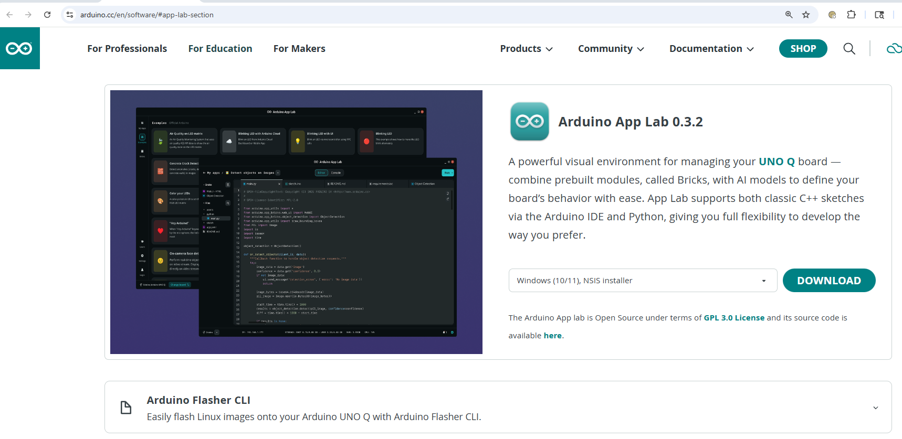

# Arduino UNO Q and VENTUNO Q App Lab Examples on /IOTCONNECT

This guide provides step-by-step instructions to set up the Arduino UNO Q or Arduino VENTUNO Q hardware and integrate
it with /IOTCONNECT, Avnet's robust IoT platform to run IoT-connected Arduino App Lab demos.

> [!NOTE]
> **Which board?** Everything here works on the UNO Q. The VENTUNO Q is supported through the
> [/IOTCONNECT brick](bricks/iotconnect/README.md) only: it runs the same `app-configs/` examples plus the
> VENTUNO Q-only examples marked `[VQ]` in the [Examples Index](#examples-index), connects on its own (direct mode) and
> does not use the relay service of section 4. See [7. VENTUNO Q Notes](#7-ventuno-q-notes) for the differences.

1. [Install Arduino App Lab on Host Machine](#1-install-arduino-app-lab-on-host-machine)
2. [Clone This Repo Onto Your Board](#2-clone-this-repo-onto-your-board)
3. [Onboard Arduino into /IOTCONNECT](#3-onboard-arduino-into-iotconnect)
4. [Set Up /IOTCONNECT SDK and Relay Service](#4-set-up-iotconnect-sdk-and-relay-service)
5. [Choose a Lab Example, Clone It, and Copy the /IOTCONNECT Files](#5-choose-a-lab-example-clone-it-and-copy-the-iotconnect-files)
6. [Run the App and Confirm Telemetry](#6-run-the-app-and-confirm-telemetry)
7. [VENTUNO Q Notes](#7-ventuno-q-notes)

> [!TIP]
> **Connecting your own app?** This repo also ships the [/IOTCONNECT brick](bricks/iotconnect/README.md), an App Lab
> custom brick that gives any app telemetry and cloud commands in a few lines of Python. Complete sections 2 and 3,
> then run `bash /home/arduino/iotc-arduino-uno-q-workshop/scripts/add_iotconnect_brick.sh <APP_LAB_FOLDER>` on the board. The relay service of section 4 is optional with
> the brick. [`examples/iotconnect-blink`](examples/iotconnect-blink/README.md) is a complete app using it.

## 1. Install Arduino App Lab on Host Machine

First, install Arduino App Lab on your PC:
   - https://www.arduino.cc/en/software/#app-lab-section

   

Then, connect the UNO Q or VENTUNO Q to your PC with a USB cable.

   

Next, enter your Wi-Fi credentials and set up connectivity.

   

Update the board when prompted.

   

> [!IMPORTANT]
> On the VENTUNO Q this update is what installs the board support (App Lab 0.14 and the `arduino:zephyr` core with the
> `ventunoq` board). Until it has completed, any app with a sketch fails to start with
> `Invalid FQBN: board arduino:zephyr:ventunoq not found`. If App Lab keeps failing to update, run the update from the
> board's terminal: `sudo arduino-app-cli system update` and then `arduino-cli core install arduino:zephyr@1.1.0`.

Now, restart the board.
 
Then, in **App Lab**, open **Examples** to view all available apps.

Finally, open the **App Lab terminal** (used to access the board's Linux terminal).

   


## 2. Clone This Repo Onto Your Board

Run these commands to clone this repository onto your Arduino to get access to the automation scripts and App Lab code: 

> [!TIP]
> Users can paste into the Arduino App Lab terminal using **RIGHT-CLICK**. Using CTRL+V is not supported in the App Lab Terminal.

```bash
sudo mkdir -p /opt/demo && sudo chown $USER /opt/demo && \
git clone https://github.com/avnet-iotconnect/iotc-arduino-uno-q-workshop.git /home/arduino/iotc-arduino-uno-q-workshop && \
chmod +x /home/arduino/iotc-arduino-uno-q-workshop/scripts/*.sh
```

> [!NOTE]
> **VENTUNO Q:** `/opt/demo` is only needed by the relay service of section 4, which the VENTUNO Q does not use, so the
> clone alone is enough (the credentials of section 3 then go to `/home/arduino/.iotconnect`):
> ```bash
> git clone https://github.com/avnet-iotconnect/iotc-arduino-uno-q-workshop.git /home/arduino/iotc-arduino-uno-q-workshop && \
> chmod +x /home/arduino/iotc-arduino-uno-q-workshop/scripts/*.sh
> ```


## 3. Onboard Arduino into /IOTCONNECT

Next you will need to onboard your device into /IOTCONNECT. This will be done via the online /IOTCONNECT user interface in 
conjunction with an automated bash script. Follow these steps to complete the process:

1. In a web browser, navigate to console.iotconnect.io and log into your account.

2. In the blue toolbar on the left edge of the page, hover over the "processor" icon and then in the resulting dropdown
   select "Device".

3. Now in the resulting Device page, click on the "Templates" tab of the blue toolbar at the bottom of the screen.

4. Right-click and then click "save link as" on [this link to the Arduino Uno Q App Lab device template](https://raw.githubusercontent.com/avnet-iotconnect/iotc-arduino-uno-q-workshop/refs/heads/main/app-configs/arduino-app-lab-template.json)
   to download the raw template file to your PC.

> [!IMPORTANT]
> Ensure that the template file saves as a `.json` file-type. Some browsers will default to a `.txt` file-type
> which is not supported by the /IOTCONNECT template import feature.

5. Back in the /IOTCONNECT browser tab, click on the "Create Template" button in the top-right of the screen.

6. Click on the "Import" button in the top-right of the resulting screen.

7. Select your downloaded copy of the template from sub-step 4 and then click "save".

> [!NOTE]
> The master template contains the telemetry fields and commands of every example in this repo, so a single device can run all of them. Each example folder also includes an optional `device-template.json` with only that example's fields; its template code is listed under "Device Template" in the example's README. If you use one, select it instead of "arduino" in sub-step 12.

8. Click on the "Devices" tab of the blue toolbar at the bottom of the screen.

9. In the resulting page, click on the "Create Device" button in the top-right of the screen.

10. Customize the "Unique ID" and "Device Name" fields to your needs (both fields should be identical though).

11. Select the most appropriate option for your device from the "Entity" dropdown (only for organization, does not
    affect connectivity).

12. Select "arduino" from the "Template" dropdown.

13. In the resulting "Device Certificate" field, select "Use my certificate." Leave this page as-is for now, you will finish it later.

14. Execute the automated device credentials script with this command:

```
bash /home/arduino/iotc-arduino-uno-q-workshop/scripts/credentials.sh
```

    The script prints the folder it writes to: `/opt/demo` when that folder exists and is writable (UNO Q with
    section 2 done as shown), otherwise `/home/arduino/.iotconnect` (VENTUNO Q). `add_iotconnect_brick.sh` looks in
    the same two places.

15. If you generated a new certificate, when prompted, press ENTER to print it.  
    If you chose to reuse existing credentials, the script may skip certificate reprint.

16. Copy **(using CTRL+C)** the device certificate text (including BEGIN and END lines) and paste the text into the 
certificate box in the /IOTCONNECT device creation page.

17. Click the "Save and View" button to go to the page for your new device.

18. Now on your device's page in /IOTCONNECT, click on the black/white/green paper-and-cog icon in the top-right of the
    device page (just above "Connection Info") to download your device's configuration file.

19. Open the configuration file in a text editor and copy its entirety to your clipboard.

20. Back in the terminal of your Arduino, paste **(using RIGHT-CLICK, because CTRL+V does not work in the App Lab Terminal)** 
the contents (of the configuration file from your clipboard as instructed by the next step of the script, and then press ENTER.

21. The onboarding process is complete. 


## 4. Set Up /IOTCONNECT SDK and Relay Service

> [!NOTE]
> This step is required for the examples under `app-configs/`, which talk to the cloud through the relay service.
> Apps that use the [/IOTCONNECT brick](bricks/iotconnect/README.md) can skip it: the brick connects on its own
> (direct mode), or uses the relay when it is installed (relay mode).
>
> **VENTUNO Q: skip this section.** The relay service and the Python Lite SDK install are UNO Q only; on the VENTUNO Q
> every example runs on the brick in direct mode (section 5, step 6, or Option A).

Run this command to install the /IOTCONNECT Python Lite SDK and then download and configure the /IOTCONNECT Relay Service.

```bash
sudo /home/arduino/iotc-arduino-uno-q-workshop/scripts/unoq_setup.sh
```

>[!NOTE]
> If during the setup script a pop-up appears asking if you would like to restart select device services, simply press 
> ENTER.

## 5. Choose a Lab Example, Clone It, and Copy the /IOTCONNECT Files

There are two ways to put an App Lab app on /IOTCONNECT:

- **Option A, the /IOTCONNECT brick**: for your own apps or any upstream example. Add the brick, then write the
  telemetry and command code yourself with its small API. See [bricks/iotconnect/README.md](bricks/iotconnect/README.md).
- **Option B, the ready-made examples** below: each folder under `app-configs/` holds a `main.py` already wired to
  the cloud, plus the matching device template and dashboard. They run on the relay client of section 4 or,
  unchanged, on the brick (step 6).

### Option A: add the /IOTCONNECT brick to an app

In Arduino App Lab, create a new app or copy an example ("Copy and edit app"), then in the App Lab terminal:

```bash
bash /home/arduino/iotc-arduino-uno-q-workshop/scripts/add_iotconnect_brick.sh <APP_LAB_FOLDER>
```

The script copies the brick into the app, lists it in `app.yaml` and either copies the device credentials into the
app or points it at the relay service, depending on whether the relay from section 4 is running. Then add to
`python/main.py`:

```python
import time

from arduino.app_utils import App
from iotconnect import IoTConnect

iotc = IoTConnect()
iotc.on_command("set-led", lambda args: print("set-led", args))  # optional


def loop() -> None:
    iotc.send_telemetry({"status": "ok"})  # from your loop or a command handler, once App.run() is running
    time.sleep(5)


App.run(user_loop=loop)
```

[`examples/iotconnect-blink`](examples/iotconnect-blink/README.md) is a complete app built this way. Make sure the
device template contains the attributes and commands your app uses (the master template covers the examples here).

### Option B: copy a ready-made example

In Arduino App Lab:
1) Browse the example applications after clicking "Examples" in the vertical toolbar on the left.
2) Click on the example application you wish to utilize.
3) Click on "Copy and edit app" in the top-right corner
4) Name your copy of the app (ideally similar to the app names in this repo)
5) Copy the /IOTCONNECT-enabled python files and relay client from the workshop repo into the app:
   ```bash
   cp /home/arduino/iotc-arduino-uno-q-workshop/app-configs/<example>/python/* /home/arduino/ArduinoApps/<APP_LAB_FOLDER>/python/ && \
   cp /opt/demo/iotc_relay_client.py /home/arduino/ArduinoApps/<APP_LAB_FOLDER>/python/
   ```
> [!TIP]
> For example, if you were using the "blink" app and you had named your copy "my-blink-app", your commands would be:
>   ```bash
>   cp /home/arduino/iotc-arduino-uno-q-workshop/app-configs/blink/python/* /home/arduino/ArduinoApps/my-blink-app/python/ && \
>   cp /opt/demo/iotc_relay_client.py /home/arduino/ArduinoApps/my-blink-app/python/
>   ```

6) Or let the /IOTCONNECT brick do the relay client's job (same `main.py`, same telemetry and commands, no code
   changes): copy the python files as above, then run the installer instead of copying the relay client:
   ```bash
   bash /home/arduino/iotc-arduino-uno-q-workshop/scripts/add_iotconnect_brick.sh <APP_LAB_FOLDER>
   ```
   Each example README shows both lines. `add_iotconnect_brick.sh <APP_LAB_FOLDER> --remove` puts the classic
   relay client back (with the unchanged `main.py`; if you copied a `brick/main.py`, copy the example's `python/main.py`
   back first). Two examples also ship a `brick/main.py` written directly against the brick's API:
   [image-classification](app-configs/image-classification/brick/main.py) and
   [object-hunting](app-configs/object-hunting/brick/main.py).

### Examples Index

Use these /IOTCONNECT-specific guides:

>[!NOTE]
>`[DB]` = dashboard image and exported /IOTCONNECT dashboard JSON template available in the example's folder.
> 
>`[AH]` = additional hardware (not provided with the board) is required for this app.
>
>`[VQ]` = Arduino VENTUNO Q only (the example uses a brick that needs the VENTUNO Q's NPU; brick-native `python/main.py`).
>
>`[UQ]` = Arduino UNO Q only (uses the UNO Q's LED matrix or pins). Everything else is in App Lab's `common` catalog on both boards.

- [air-quality-monitoring](app-configs/air-quality-monitoring/README.md) `[DB]`
- [anomaly-detection](app-configs/anomaly-detection/README.md)
- [audio-classification](app-configs/audio-classification/README.md) `[DB]`
- [bedtime-story-teller](app-configs/bedtime-story-teller/README.md)
- [blink](app-configs/blink/README.md)
- [blink-with-ui](app-configs/blink-with-ui/README.md)
- [chatbot-cloud-llm](app-configs/chatbot-cloud-llm/README.md)
- [cloud-blink](app-configs/cloud-blink/README.md)
- [code-detector](app-configs/code-detector/README.md) `[AH]`
- [color-your-leds](app-configs/color-your-leds/README.md) `[UQ]`
- [edge-ai-assistant](app-configs/edge-ai-assistant/README.md)
- [edge-dictation-assistant](app-configs/edge-dictation-assistant/README.md) `[VQ]` `[AH]`
- [edge-speech-assistant](app-configs/edge-speech-assistant/README.md) `[VQ]` `[AH]`
- [gesture-booth](app-configs/gesture-booth/README.md) `[VQ]` `[AH]`
- [home-climate-monitoring-and-storage](app-configs/home-climate-monitoring-and-storage/README.md) `[DB]` `[AH]`
- [image-classification](app-configs/image-classification/README.md) `[DB]`
- [keyword-spotting](app-configs/keyword-spotting/README.md)  `[AH]`
- [led-matrix-painter](app-configs/led-matrix-painter/README.md)
- [mascot-jump-game](app-configs/mascot-jump-game/README.md)
- [mobile-remote-sensor](app-configs/mobile-remote-sensor/README.md) `[AH]`
- [mobile-video-generic-object-detection](app-configs/mobile-video-generic-object-detection/README.md) `[AH]`
- [music-composer](app-configs/music-composer/README.md) `[AH]`
- [object-detection](app-configs/object-detection/README.md) `[DB]`
- [object-hunting](app-configs/object-hunting/README.md) `[AH]`
- [pose-detection](app-configs/pose-detection/README.md) `[VQ]` `[AH]`
- [real-time-accelerometer](app-configs/real-time-accelerometer/README.md) `[DB]` `[AH]`
- [smart-mirror](app-configs/smart-mirror/README.md) `[VQ]` `[AH]`
- [system-resources-logger](app-configs/system-resources-logger/README.md) `[DB]`
- [telegram-bot](app-configs/telegram-bot/README.md)
- [theremin](app-configs/theremin/README.md) `[AH]`
- [unoq-pin-toggle](app-configs/unoq-pin-toggle/README.md) `[UQ]`
- [vibration-anomaly-detection](app-configs/vibration-anomaly-detection/README.md) `[DB]` `[AH]`
- [video-face-detection](app-configs/video-face-detection/README.md) `[DB]` `[AH]`
- [video-generic-object-detection](app-configs/video-generic-object-detection/README.md) `[DB]` `[AH]`
- [video-person-classification](app-configs/video-person-classification/README.md) `[DB]` `[AH]`
- [weather-forecast](app-configs/weather-forecast/README.md)

---

## 6. Run the App and Confirm Telemetry

1) Run the app in App Lab.
2) Confirm telemetry appears in /IOTCONNECT.
3) If you enabled commands, test a command from /IOTCONNECT and verify the app receives it.

Expected result: the selected App Lab example runs on the board and publishes telemetry to /IOTCONNECT.

> [!TIP]
> You can manually manage the /IOTCONNECT Relay Service on your UNO Q (the VENTUNO Q has no relay service).
>
> To disconnect your device from /IOTCONNECT, stop the relay service:
> ```bash
> sudo systemctl stop iotc-relay
> ```
>
> To start it again:
> ```bash
> sudo systemctl start iotc-relay
> ```
>
> To restart:
> ```bash
> sudo systemctl restart iotc-relay
> ```
>
> If telemetry does not show up and logs report `Address already in use`, check what is bound to TCP port `8899`:
> ```bash
> sudo ss -ltnp | grep ':8899'
> ```
> If a conflicting bridge service is using that port (for example `iotc-socat`), stop it and restart relay:
> ```bash
> sudo systemctl disable --now iotc-socat
> sudo systemctl restart iotc-relay
> ```

---

## 7. VENTUNO Q Notes

The Arduino VENTUNO Q runs the same App Lab, so sections 1 to 3 and 5 to 6 apply unchanged. What differs:

- **Brick only.** The VENTUNO Q does not run the relay service or the Python Lite SDK install of section 4. Every app
  connects through the [/IOTCONNECT brick](bricks/iotconnect/README.md) in direct mode:
  `bash /home/arduino/iotc-arduino-uno-q-workshop/scripts/add_iotconnect_brick.sh <APP_LAB_FOLDER>` picks direct mode
  by itself when no relay is running (add `--direct` to insist). Each board is its own /IOTCONNECT device: create one per
  board in section 3 (the `arduino` master template serves both).
- **Credentials folder.** Without `/opt/demo`, `scripts/credentials.sh` writes `device-cert.pem`, `device-pkey.pem` and
  `iotcDeviceConfig.json` to `/home/arduino/.iotconnect`, and the installer copies them from there into
  `<app>/data/iotconnect`. Delete `data/iotconnect` before exporting or sharing an app.
- **Examples.** The `app-configs/` examples from App Lab's `common` catalog run on the VENTUNO Q with the same
  `python/main.py` through the brick's drop-in relay-client API (section 5, step 6). The examples marked `[VQ]`
  (gesture-booth, smart-mirror, edge-speech-assistant, edge-dictation-assistant, pose-detection) exist only on the
  VENTUNO Q and ship a `python/main.py` written directly against the brick API, with their own telemetry and commands.
  Those fields are part of the master template; re-import `app-configs/arduino-app-lab-template.json` (or add the
  attributes to your existing template) if you imported it before they were added. The `edge-ai-assistant` and
  `video-face-detection` examples exist for both boards with the same Python code; only the model named in the
  example's `app.yaml` differs.
- **Board update.** The App Lab update in section 1 installs the VENTUNO Q board support. Sketch-based apps need the
  `arduino:zephyr` core 1.1.0 or newer (it lists the `ventunoq` board); the `[VQ]` examples have no sketch.
- **App Lab CLI.** The CLI names apps by ID: `arduino-app-cli app start user:<APP_LAB_FOLDER>`,
  `arduino-app-cli app logs user:<APP_LAB_FOLDER>`. One app runs at a time, as on the UNO Q.

Verified on a VENTUNO Q with App Lab 0.14.0, zephyr core 1.1.0 and a Logitech C920 webcam (camera + microphone),
all in direct mode as device `ventunoQ0`: `blink` with its sketch through the brick shim (telemetry, `set-led`),
`video-face-detection` through the shim (live face detections, `set-confidence`, `run-detect`), and the five `[VQ]`
examples natively: `gesture-booth` and `pose-detection` (runners healthy, `set-interval`), `edge-dictation-assistant`
(`set-language`, `start-dictation` with `listening`/`stopped` telemetry), `smart-mirror` (scans from the page and from
the `scan-look` command with the VLM's answer in the telemetry) and `edge-speech-assistant` both with a USB speaker
(a cloud `speak` played and reported `started` then `finished`) and without one (stays connected, `speak` is acked
as failed with the reason). The `tts`, `asr` and `vlm` models were installed first
with `arduino-app-cli model install whisper-small-quantized`, `melo-tts-en` and `genie:qwen3_vl_4b_instruct`.
